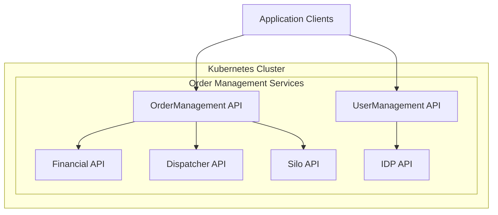
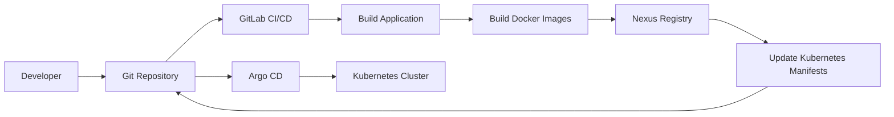
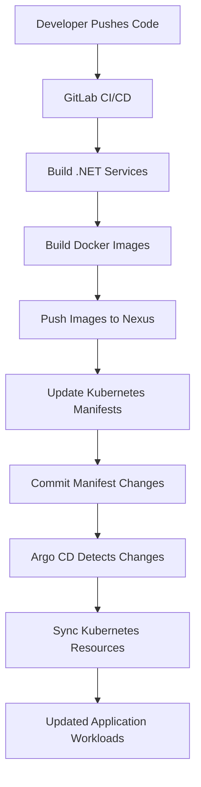

# Order Management – Kubernetes Deployment

[](https://dotnet.microsoft.com/)
[](https://www.docker.com/)
[](https://kubernetes.io/)
[](https://docs.gitlab.com/ee/ci/)
[](https://argo-cd.readthedocs.io/)

A containerized .NET microservices application deployed on Kubernetes, using GitLab CI/CD, Nexus Container Registry, and Argo CD for automated image delivery and GitOps-based deployment management.

This repository demonstrates a DevOps workflow for building, publishing, and deploying multiple independent .NET services in a Kubernetes environment.

---

## Table of Contents

- [Overview](#overview)
- [Architecture](#architecture)
- [Microservices](#microservices)
- [Technology Stack](#technology-stack)
- [CI/CD Pipeline](#cicd-pipeline)
- [Docker Image Management](#docker-image-management)
- [Kubernetes Deployment](#kubernetes-deployment)
- [GitOps with Argo CD](#gitops-with-argo-cd)
- [Deployment Lifecycle](#deployment-lifecycle)
- [Repository Structure](#repository-structure)
- [Documentation](#documentation)
- [Security Considerations](#security-considerations)
- [Future Improvements](#future-improvements)
- [Author](#author)

---

## Overview

The Order Management project is a distributed application composed of multiple .NET-based services.

Each service is packaged as a Docker image and deployed independently, allowing application components to be built and released separately.

The DevOps workflow automates the application delivery process through:

- GitLab CI/CD for automated builds.
- Docker for application containerization.
- Nexus Repository for private Docker image storage.
- Kubernetes for container orchestration.
- Argo CD for GitOps-based deployment synchronization.

The primary objective is to provide a repeatable deployment workflow and manage application releases through version-controlled Kubernetes manifests.

## Architecture

The application follows a microservices architecture. Each service has a dedicated responsibility and is managed as an independent deployment unit.

### Application Architecture



*Note: This diagram represents the logical service landscape. The exact communication paths and dependencies should be confirmed against the application implementation.*

### DevOps Architecture



## Microservices

The application consists of six independent services:

| Service | Responsibility |
|---|---|
| OrderManagement API | Order management operations |
| UserManagement API | User management operations |
| Financial API | Financial operations |
| IDP API | Identity provider and authentication-related operations |
| Silo API | Silo application services |
| Dispatcher API | Dispatching operations |

Each service has its own application build and container image.

## Technology Stack

| Category | Technology |
|---|---|
| Application Framework | .NET 9 |
| Application Architecture | Microservices |
| Containerization | Docker |
| Container Orchestration | Kubernetes |
| CI/CD | GitLab CI/CD |
| Container Registry | Nexus Repository |
| GitOps | Argo CD |
| Deployment Configuration | Kubernetes YAML Manifests |
| Version Control | Git |

## CI/CD Pipeline

GitLab CI/CD is used to automate the application build and container delivery workflow.

The pipeline builds application components, creates Docker images, publishes them to Nexus, and updates Kubernetes deployment configurations.

### Main Pipeline Activities

#### 1. Build

- Builds the .NET application components.
- Uses the configured .NET SDK and project build settings.
- Prepares application artifacts for containerization.

#### 2. Docker Image Build and Push

- Builds Docker images for the application services.
- Tags images using the Git commit short SHA.
- Authenticates with the configured Nexus Container Registry.
- Pushes the generated images to the registry.

Example image tag format:

```text
<registry>/<repository>/<service>:<commit-sha>
```

#### 3. Kubernetes Manifest Update

- Updates the image references in Kubernetes manifests.
- Uses the newly generated image tags.
- Commits the manifest changes to the Git repository.

This allows the deployment configuration to remain version-controlled and traceable to the corresponding application source revision.

## Docker Image Management

Docker is used to package each .NET service and its runtime dependencies into an independent container image.

Nexus Repository acts as the private container registry.

The image versioning strategy uses the Git commit short SHA:

```text
CI_COMMIT_SHORT_SHA
```

This provides a traceable relationship between:

- Application source code.
- CI/CD pipeline execution.
- Docker image version.
- Kubernetes deployment configuration.

Example:

```text
<registry>/<repository>/ordermanagement-api:<commit-sha>
```

The same image-tagging approach is used for the other application services.

## Kubernetes Deployment

Kubernetes manages the lifecycle of the containerized application services.

Each service is deployed through declarative Kubernetes manifests.

The deployment configuration is maintained in the repository and includes Kubernetes workload and networking resources.

### Kubernetes Resources

The project uses Kubernetes manifests to manage application resources such as:

- Namespaces
- Deployments
- Services
- Application configuration

### Useful Kubernetes Commands

Check cluster nodes:

```bash
kubectl get nodes
```

List application namespaces:

```bash
kubectl get namespaces
```

List pods in a namespace:

```bash
kubectl get pods -n <namespace>
```

List deployments:

```bash
kubectl get deployments -n <namespace>
```

List services:

```bash
kubectl get services -n <namespace>
```

Inspect a deployment:

```bash
kubectl describe deployment <deployment-name> -n <namespace>
```

View application logs:

```bash
kubectl logs <pod-name> -n <namespace>
```

*Replace placeholders with the actual namespace and resource names used in the cluster.*

## GitOps with Argo CD

Argo CD is used to manage Kubernetes application synchronization based on the desired state stored in Git.

Instead of relying exclusively on manual deployment commands, Kubernetes manifests are maintained in version control and monitored by Argo CD.

When the deployment manifests are updated in Git, Argo CD can detect the changes and synchronize the cluster with the repository state according to the configured application synchronization policy.

### GitOps Workflow

1. GitLab CI/CD builds and publishes updated application images.
2. Kubernetes manifests are updated with the new image references.
3. Manifest changes are committed to Git.
4. Argo CD detects the repository changes.
5. Argo CD synchronizes the desired application state with Kubernetes.

### Benefits

- Declarative deployment management.
- Version-controlled infrastructure configuration.
- Traceable deployment changes.
- Consistent application synchronization.
- Easier review and rollback of configuration changes.

## Deployment Lifecycle

The complete application delivery workflow can be summarized as follows:



This workflow separates application build and image publishing from Kubernetes deployment synchronization.

## Repository Structure

The repository is organized around application source code, Kubernetes deployment manifests, and CI/CD configuration.

```text
order-management-kubernetes/
│
├── src/
│   ├── Dispatcher.API/
│   ├── Financial.API/
│   ├── IDP.API/
│   ├── OrderManagement.API/
│   ├── Silo.API/
│   └── UserManagement.API/
│
├── k8s/
│   ├── dispatcher/
│   ├── financial/
│   ├── idp/
│   ├── order-management/
│   ├── silo/
│   └── usermanagement/
│
├── .gitlab-ci.yml
└── README.md
```

*This is a logical overview of the project structure. Additional application files, Dockerfiles, configuration files, and Kubernetes resources may exist in the repository.*

## Documentation

This README provides an overview of the application architecture and DevOps workflow.

Additional documentation can be added to cover:

- Application architecture and service dependencies.
- CI/CD pipeline implementation.
- Kubernetes deployment configuration.
- Argo CD application configuration.
- Operational procedures and troubleshooting.

## Security Considerations

Security should be considered throughout the application build and deployment lifecycle.

Recommended practices include:

- Never commit passwords, access tokens, or registry credentials.
- Store sensitive CI/CD values in protected GitLab CI/CD variables.
- Use Kubernetes Secrets for sensitive application configuration.
- Restrict access to private container registries.
- Apply least-privilege permissions to Kubernetes resources.
- Avoid exposing internal infrastructure addresses and configuration details.
- Regularly update application dependencies and container base images.

## Future Improvements

Potential improvements for the platform include:

- Prometheus and Grafana monitoring.
- Centralized application logging.
- Automated container image vulnerability scanning.
- Kubernetes resource requests and limits.
- Kubernetes NetworkPolicies.
- Automated deployment validation.
- Health checks and readiness/liveness probes.
- Improved deployment observability and rollback procedures.

## Author

**Mahbod Rahimian**

DevOps Engineer

[GitHub Profile](https://github.com/MahbodRahimian)
